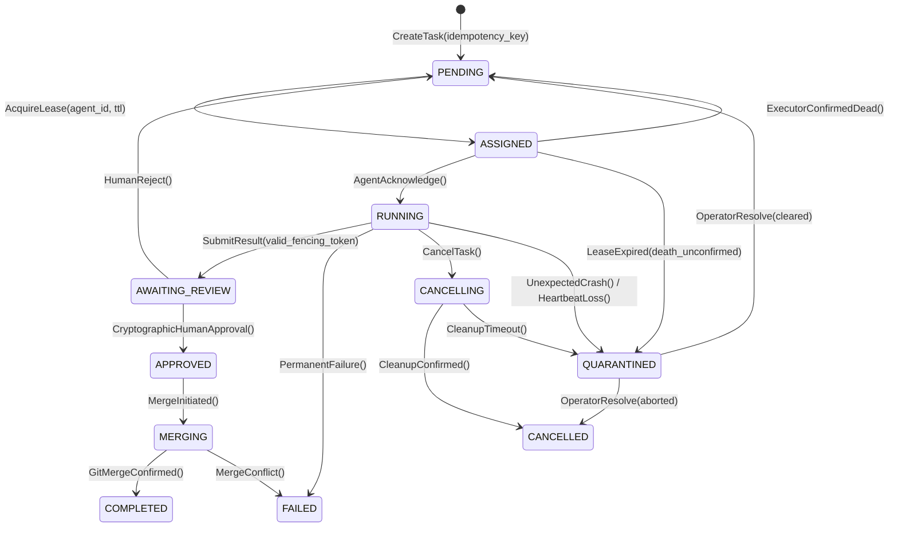

# DUALITY CORE — Arquitectura de Orquestación Multiagente (DMAOL)
**Fase 1B: Corrección de Defectos de Concurrencia, Fencing y Persistencia**

**Fecha:** 2026-10-21  
**Rama:** `ag/architecture`  
**Estado:** Experimental / En desarrollo. **No apto para producción.**

---

## 1. Alcance y Tratamiento de Hallazgos de la Auditoría Adversarial

La Fase 1B resuelve los seis hallazgos detectados en la auditoría técnica de DMAOL:

1. **Exclusión Mutua Interproceso (`CrossPlatformFileLock`):**
   - Se implementa un bloqueo de archivo a nivel de kernel mediante `msvcrt.locking` en Windows y `fcntl.flock` en POSIX sobre `.store.lock`.
   - Se elimina la dependencia de estructuras en memoria para el bloqueo de rutas: `LeaseManager` escanea los leases activos directamente en el almacén de tareas bajo el lock del sistema.
2. **Aceptación Atómica de Resultados (`submit_execution_result`):**
   - La comprobación de la versión de estado, la verificación de expiración del lease y la validación del fencing token se unifican en una transacción atómica bajo el lock del almacén.
3. **Prohibición Estricta de `RUNNING → PENDING`:**
   - La tabla `VALID_TRANSITIONS` elimina `PENDING` como destino directo desde `RUNNING`. Toda falla inesperada o interrupción de latido transiciona obligatoriamente a `QUARANTINED` o `CANCELLING`.
4. **Reconciliación Bidireccional de Idempotencia:**
   - Se escribe el mapeo de idempotencia antes de consolidar el registro de la tarea.
   - En `recover_on_startup`, se reconstruyen entradas de idempotencia faltantes para tareas huérfanas y se purgan mapeos huérfanos sin tarea asociada.
5. **Detección Reforzada de Symlinks y NTFS Junctions:**
   - `PathSecurity.is_reparse_point_or_symlink` inspecciona `FILE_ATTRIBUTE_REPARSE_POINT` (0x0400) en Windows y `stat.S_ISLNK` en POSIX componente por componente, rechazando cualquier escape o montaje de reparse point.
6. **Autenticación Criptográfica de Aprobación Humana:**
   - Se sustituye la validación trivial de strings por firmas HMAC-SHA256 (`CryptographicHumanGate`) generadas y verificadas con una clave secreta del operador humano.

---

## 2. Matriz de Estados Actualizada



---

## 3. Garantías y Límites Multiplataforma (Windows vs. Linux)

- **Locking:** En Windows se usa `msvcrt.locking(fd, LK_NBLCK, 1)` y en Linux `fcntl.flock(fd, LOCK_EX | LOCK_NB)`. Ambos son bloqueos a nivel de kernel entre procesos independientes.
- **Atomic Rename:** `os.replace` es atómico en ambos sistemas operativos (POSIX rename y NTFS MoveFileEx con flag de reemplazo).
- **Directory Fsync:** En POSIX se ejecuta `os.fsync(dir_fd)` sobre el descriptor del directorio; en Windows se confía en la consistencia transaccional del journal de NTFS.
- **Rutas:** Se rechazan nombres de dispositivo reservados en Windows (`CON`, `PRN`, `AUX`, `NUL`, etc.) y colisiones insensibles a mayúsculas/minúsculas.

---

## 4. Fase 3A: Integración Simulada de Extremo a Extremo (Operación FIRST CONTACT)

### 4.1. Resumen y Objetivos
La Operación **FIRST CONTACT** valida de forma reproducible e integrada el ciclo de vida multiagente de DUALITY CORE sin tocar infraestructura de producción ni interactuar con servicios reales. Se simulan dos agentes con roles y rutas independientes:
- `codex-sim`: Agente de backend (`src/backend/persistence_driver.py`, rama `duality/task-backend-001/codex-sim`).
- `antigravity-sim`: Agente de interfaz/monitoreo (`src/frontend/AgentMonitor.tsx`, rama `agent/antigravity-sim/task-ui-002`).

### 4.2. Flujo Completo y Transiciones Observadas
Ambos agentes transicionan con éxito a través de las fases:
```
PENDING → ASSIGNED → RUNNING → AWAITING_REVIEW → APPROVED → MERGING → COMPLETED
```
1. **Creación e Idempotencia:** La tarea se genera con un digest determinista SHA-256 de su carga. Intentos de duplicación devuelven la tarea existente; discrepancias de carga lanzan `IdempotencyConflictError`.
2. **Lease con Generación Monótona:** Adquisición con TTL y bloqueo atómico interproceso. Se emite un `fencing_token` incremental.
3. **Ejecución y Aceptación Atómica (`submit_execution_result`):** Se valida la coincidencia estricta de `expected_version` y `expected_fencing_token` bajo el cerrojo del kernel antes de permitir `AWAITING_REVIEW`.
4. **Comprobación Criptográfica Humana:** Se valida la decisión del operador (`APPROVED` o `REJECTED`) mediante firma HMAC-SHA256 con clave secreta efímera del test.
5. **Merge y Finalización:** La política de ramas valida que solo tareas aprobadas por humanos accedan a ramas protegidas (`main`), registrando `GitMergeRecord` antes de `COMPLETED`.
6. **Persistencia y Recuperación:** Reinicio en frío del almacén (`TaskStore`) verifica la recuperación intacta de los estados finales.

### 4.3. Modelo de Rechazo y Limitaciones Arquitectónicas
Se verificaron los caminos de rechazo del modelo y sus restricciones intencionales:
- **Rechazo para Retrabajo (`AWAITING_REVIEW → PENDING`):** Permitido. El operador documenta observaciones en `HumanApproval` y devuelve la tarea a la cola sin ejecutar merge.
- **Rechazo Definitivo / Cancelación (`AWAITING_REVIEW → CANCELLING → CANCELLED`):** Permitido. Descarta la tarea limpiando leases de manera controlada.
- **Limitación Arquitectónica Verificada (`AWAITING_REVIEW → FAILED` es Ilegal):**
  La máquina de estados prohíbe explícitamente `AWAITING_REVIEW → FAILED`, arrojando `IllegalStateTransitionError`. Por diseño en DMAOL:
  - Una revisión humana negativa no indica una falla irrecuperable de infraestructura o ejecución de proceso, sino un juicio cualitativo.
  - Para preservar una semántica de auditoría limpia, las fallas técnicas se reservan a `RUNNING → FAILED` o `MERGING → FAILED`. Un rechazo de revisión debe canalizarse vía retrabajo (`PENDING`) o aborto formal (`CANCELLING → CANCELLED`).

### 4.4. Comando de Reproducción
```powershell
python -m orchestration.demo
python -m unittest tests/orchestration/test_first_contact.py -v
```

