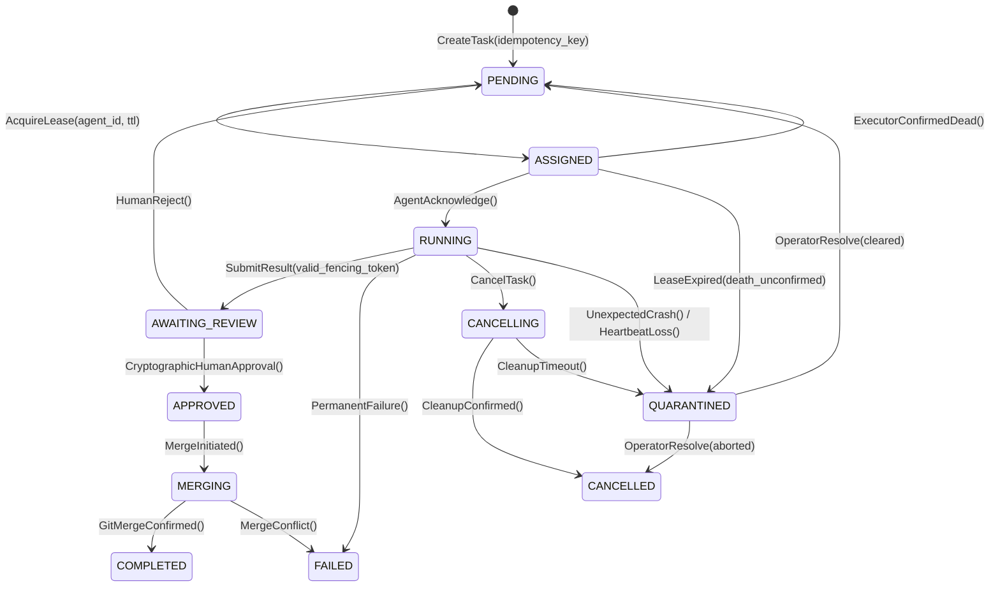

# DUALITY CORE — Arquitectura de Orquestación Multiagente (DMAOL)
**Fase 1B: Corrección de Defectos de Concurrencia, Fencing y Persistencia**

**Fecha:** 2026-10-21  
**Rama:** `ag/architecture`  
**Estado:** Experimental / En desarrollo. **No apto para producción.**

---

## 1. Alcance y Tratamiento de Hallazgos de la Auditoría Adversarial

La Fase 1B resuelve los seis hallazgos detectados en la auditoría técnica de DMAOL:

1. **Exclusión Mutua Interproceso (`CrossPlatformFileLock`):**
   - Se implementa un bloqueo de archivo a nivel de kernel mediante `msvcrt.locking` en Windows y `fcntl.flock` en POSIX sobre `.store.lock`.
   - Se elimina la dependencia de estructuras en memoria para el bloqueo de rutas: `LeaseManager` escanea los leases activos directamente en el almacén de tareas bajo el lock del sistema.
2. **Aceptación Atómica de Resultados (`submit_execution_result`):**
   - La comprobación de la versión de estado, la verificación de expiración del lease y la validación del fencing token se unifican en una transacción atómica bajo el lock del almacén.
3. **Prohibición Estricta de `RUNNING → PENDING`:**
   - La tabla `VALID_TRANSITIONS` elimina `PENDING` como destino directo desde `RUNNING`. Toda falla inesperada o interrupción de latido transiciona obligatoriamente a `QUARANTINED` o `CANCELLING`.
4. **Reconciliación Bidireccional de Idempotencia:**
   - Se escribe el mapeo de idempotencia antes de consolidar el registro de la tarea.
   - En `recover_on_startup`, se reconstruyen entradas de idempotencia faltantes para tareas huérfanas y se purgan mapeos huérfanos sin tarea asociada.
5. **Detección Reforzada de Symlinks y NTFS Junctions:**
   - `PathSecurity.is_reparse_point_or_symlink` inspecciona `FILE_ATTRIBUTE_REPARSE_POINT` (0x0400) en Windows y `stat.S_ISLNK` en POSIX componente por componente, rechazando cualquier escape o montaje de reparse point.
6. **Autenticación Criptográfica de Aprobación Humana:**
   - Se sustituye la validación trivial de strings por firmas HMAC-SHA256 (`CryptographicHumanGate`) generadas y verificadas con una clave secreta del operador humano.

---

## 2. Matriz de Estados Actualizada

---

## 3. Garantías y Límites Multiplataforma (Windows vs. Linux)

- **Locking:** En Windows se usa `msvcrt.locking(fd, LK_NBLCK, 1)` y en Linux `fcntl.flock(fd, LOCK_EX | LOCK_NB)`. Ambos son bloqueos a nivel de kernel entre procesos independientes.
- **Atomic Rename:** `os.replace` es atómico en ambos sistemas operativos (POSIX rename y NTFS MoveFileEx con flag de reemplazo).
- **Directory Fsync:** En POSIX se ejecuta `os.fsync(dir_fd)` sobre el descriptor del directorio; en Windows se confía en la consistencia transaccional del journal de NTFS.
- **Rutas:** Se rechazan nombres de dispositivo reservados en Windows (`CON`, `PRN`, `AUX`, `NUL`, etc.) y colisiones insensibles a mayúsculas/minúsculas.
